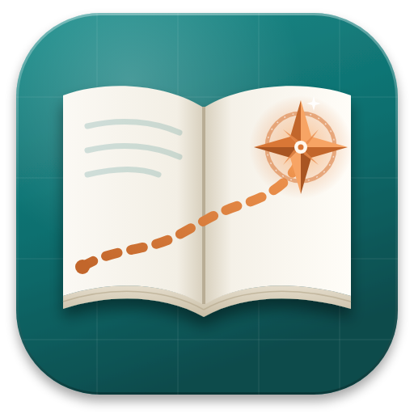
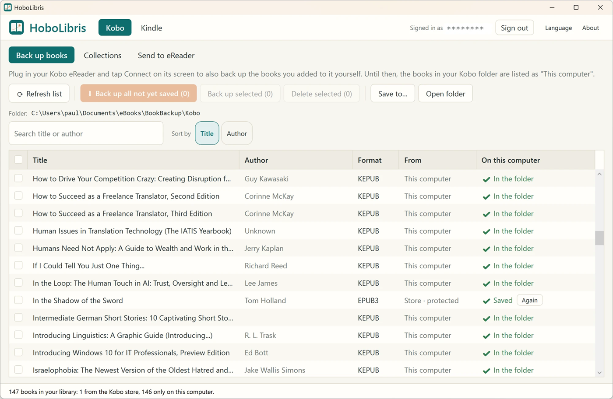

<p align="center">
  
</p>

<h1 align="center">HoboLibris</h1>

<p align="center">
  <strong>Let your books wander.  A copy always stays home.</strong>
</p>

<p align="center">
  A Windows desktop app that keeps a copy of your Kobo and Kindle books on your computer,<br>
  sorts your Kobo eReader into collections, sends your own books to it,<br>
  and has an Assistant that does it for you when you ask.
</p>

<p align="center">
  <a href="https://github.com/paulfilkin/HoboLibris/releases/latest">Download</a> ·
  <a href="#getting-started">Getting started</a> ·
  <a href="Docs/HoboLibris-Mechanics.md">How it works</a> ·
  <a href="CONTRIBUTING.md">Contributing</a>
</p>

## Why

E-books live in other people's places: a store account, an eReader, a reading app.  Getting a copy of your own is harder than it should be.

Kobo's desktop app downloads your books, but Windows stretches it on high-resolution screens until it is hard to use.  Amazon stopped offering Kindle book downloads in February 2025, so the copies already on your Kindle, or in Kindle for PC, are the ones you can still reach.  Collections on a Kobo eReader are sorted one book at a time, on its small screen.

HoboLibris puts all of that in one window that stays sharp on high-resolution screens.  Sign in to Kobo, plug in your eReader or Kindle, and press one button to back up everything not yet saved.  Books are copied exactly as they are delivered: nothing is decrypted, converted or uploaded anywhere.

## What it does

- **Backs up your Kobo store books.**  It signs in to your Kobo account the way the Kobo desktop app does, lists every book you bought, and downloads each one to a folder you choose, as `Title - Author.epub`.  Unprotected copies come first; protected ones are saved exactly as Kobo delivers them.
- **Backs up the books you added to your Kobo eReader.**  Plug it in and tap Connect, and the books you put on it yourself join the list, with titles and authors from the eReader's own book list.  A book that is also in your store list is marked, so it is not saved twice.
- **Sorts your eReader into collections.**  See which collection each book is in, show only the books in none, then create, rename, move and remove in a proper window.  Nothing changes on the eReader until you save, and its book list is copied to your computer first.  With the eReader unplugged, the collections open as they were last seen, and your changes are merged with the eReader's own when it is plugged in again.
- **Keeps your Instapaper articles.**  The articles you saved to the eReader with Instapaper are listed.  Keep the ones worth keeping as a single web page each, with its pictures, and remove the rest from the eReader.
- **Lists your store previews and wishlist.**  The free samples on the eReader, with a link to each in the Kobo store, and the wishlist in your Kobo account.  Add previews to the wishlist, or take books off it, through the eReader: the change reaches your account the next time it syncs.  Remove previews you saved or opened from a search; the screen marks those that come back after a sync.
- **Sends your own books to the eReader.**  Books you put in your Kobo folder are checked: whether a Kobo can open them, whether they are damaged or copy-protected, and whether the eReader already has them.  Then they are copied across.  It can do this by itself each time the eReader is plugged in.
- **Backs up your Kindle books.**  From a Kindle plugged in by USB, with or without a drive letter, from Kindle for PC, or from any folder you add.  Each book is copied unchanged, with its sidecar folder where it has one.
- **Has an Assistant.**  Ask in plain words: "back up everything not yet saved", "sort my eReader into collections by subject", "find Middlemarch on Project Gutenberg".  It uses the AI model you choose, from Anthropic, OpenAI or one on your own computer such as Ollama, and works through the same screens, so you see what it did.  It finds free books on Project Gutenberg, Open Library and Google Books, and in your own OPDS catalogues such as Calibre, and downloads them into your Kobo folder.  Anything that writes to the eReader or deletes files waits for your approval, and your Kobo sign-in, tokens and email address are never sent to the model.
- **Asks before removing anything.**  Deleted backups go to the Recycle Bin.  Nothing on the eReader is removed unless you tick the box that says so.
- **Comes in 12 languages.**  English, German, French, Spanish, Italian, Portuguese, Japanese, Chinese, Korean, Arabic, Hebrew and Ukrainian, with right-to-left layout for Arabic and Hebrew.

## The screens

<p align="center">
  
</p>

| Screen | What it does |
|---|---|
| Kobo: Back up books | One list of your store books, your eReader books and the books only on this computer, with what is saved and a button for the rest |
| Kobo: Collections | Your eReader's collections and the books in each, changed here and saved in one go, with the eReader plugged in or not |
| Kobo: Send to eReader | The books in your Kobo folder, whether each is ready to send, and why not when it isn't |
| Kobo: Articles | The Instapaper articles on your eReader and the copies kept on this computer |
| Kobo: Previews | The store previews on your eReader, and your Kobo wishlist |
| Kindle | The books on your Kindle, in Kindle for PC or in folders you add, and what is backed up |
| Assistant | A pane beside every screen: ask in plain words, and approve what changes anything |

Drag the divider between two panels to change their widths, or fold the Assistant or the list of collections to a strip at the edge.  HoboLibris remembers both, and folds the Assistant by itself when the window gets too narrow.

## Getting started

You need Windows 10 or 11, 64-bit.

1. Download `HoboLibrisSetup-<version>.exe` from the [latest release](https://github.com/paulfilkin/HoboLibris/releases/latest) and run it.  It installs for you alone, without an administrator password, and brings everything it needs.
2. On the **Kobo** tab, press **Sign in** and sign in to your Kobo account in the window that opens.  Your library loads by itself.
3. Press **Back up all not yet saved**.  The books go to `Documents\HoboLibris\Kobo`; to use another folder, change it first in **Settings** (the gear icon at the top right).
4. Plug in your Kobo eReader and tap **Connect** on its screen.  The books you added to it join the list, and the **Collections**, **Send to eReader**, **Articles** and **Previews** screens can work with it.
5. On the **Kindle** tab, plug in your Kindle.  If it doesn't appear, the tab says what Windows can see and what to do next.
6. To use the Assistant, choose an AI service in **Settings**, under **AI model**: Anthropic or OpenAI with your API key, or a model on your computer, which needs no key.  For [Ollama](https://ollama.com), choose **OpenAI-compatible** and `http://localhost:11434/v1`.  HoboLibris then uses Ollama's own API, with the context size set in Settings (8,192 tokens unless you change it).  HoboLibris can start Ollama for you, with no window, and stops it again when you close HoboLibris.  Once HoboLibris has reached the service, the **Model** list shows the models it offers; choose one.  Then press the chat icon at the top right.

The release also has a zip with just the program.  It needs the [.NET 8 Desktop Runtime](https://dotnet.microsoft.com/download/dotnet/8.0) installed.

HoboLibris keeps its settings, your Kobo sign-in and its logs in `%APPDATA%\HoboLibris`, and the Assistant's conversation and the Project Gutenberg catalogue in its `Assistant` folder.  API keys, catalogue sign-ins and the conversation are encrypted for your Windows account.  The copies of the eReader's book list it takes before changing it go in `%APPDATA%\HoboLibris\Kobo book list backups` unless you choose another folder in **Settings**.  The eReader's collections, with any changes not yet saved to it, are kept in `%APPDATA%\HoboLibris\Collections`, one file for each eReader.  Kept articles go in `Documents\HoboLibris\Articles` unless you choose another folder.  Uninstalling leaves all of them, and your books, where they are.

## From a terminal

| Switch | What it does |
|---|---|
| `--screenshot <file.png>` | Saves a picture of the main window after four seconds, then closes |
| `--kindle`, `--send`, `--collections` | With `--screenshot`, shows that screen first |
| `--theme light`, `--theme dark` | Shows HoboLibris light or dark for this run, whatever is chosen in Settings |
| `--assistant` | With `--screenshot`, opens the Assistant pane with a sample exchange, in a wider window |

## Building from source

You need the .NET 8 SDK, and Inno Setup 6 for the installer.

```powershell
gh repo clone paulfilkin/HoboLibris
```

```powershell
cd HoboLibris
```

```powershell
dotnet run --project HoboLibris\HoboLibris\HoboLibris.csproj
```

```powershell
dotnet test HoboLibris\HoboLibris.Tests\HoboLibris.Tests.csproj
```

The installer:

```powershell
dotnet publish HoboLibris\HoboLibris\HoboLibris.csproj -c Release -r win-x64 --self-contained
```

```powershell
& "C:\Program Files (x86)\Inno Setup 6\ISCC.exe" HoboLibris\HoboLibris.iss
```

The solution is in `HoboLibris\`.  In the app, `Services\` holds the work with the store, the devices and the files, `Assistant\` the Assistant, its tools and the e-book sources, `ViewModels\` and `Views\` the screens, `Windows\` the dialogs, `Themes\` the colours and styles, and `Resources\` the text in each language.  `HoboLibris.Tests\` holds the unit tests, and `Tools\` the two string scripts.

All text in the app is in `Resources\Strings.resx`, with one `Strings.<language>.resx` for each translation.  After adding or renaming a string, regenerate the strongly typed class, which the build does not do, and check the translations:

```powershell
powershell -NoProfile -File HoboLibris\Tools\Update-Strings.ps1
```

```powershell
powershell -NoProfile -File HoboLibris\Tools\Check-Translations.ps1
```

The app uses NLog, CommunityToolkit.Mvvm, Microsoft.Web.WebView2 for the Kobo sign-in page, Microsoft.Data.Sqlite for the eReader's book list, and System.Management for the Kindle connection check.

## Status

HoboLibris is at version 0.1.18.  It is a WPF rebuild of an earlier prototype that was used with a real Kobo account, Kobo eReader and Kindle, and it keeps the prototype's behaviour and tests.

Tried with a Kobo account and a Kobo eReader (firmware 4.46): the store list refreshes from a saved sign-in, store books download, books copy from the eReader, collections are saved to it, the Send to eReader screen reads it, articles are kept and removed, books are added to and taken off the wishlist, and previews are removed.  Not yet tried on the rebuild: signing in from scratch, sending books to the eReader, the Kindle tab, and editing collections offline and then merging them with a real eReader.

The Assistant has been tried with a model on the same computer (Ollama with `qwen3:8b`, at a context size of 8,192 and 4,096): questions about the library, Project Gutenberg searches and downloads, sending, the Kindle and collections, and starting and stopping Ollama from Settings.  Not yet tried: Anthropic and OpenAI models, Google Books and OPDS catalogues.

Ejecting the Kobo eReader from HoboLibris failed in 0.1.6 because HoboLibris itself kept the eReader's book list open.  It is fixed in 0.1.7, with a test, but not yet tried with a real eReader.

An ejected eReader can't be reconnected without unplugging it, since it leaves the USB connection when ejected ([#63](https://github.com/paulfilkin/HoboLibris/issues/63)).

It runs on Windows only.  Bugs and ideas are welcome as [issues](https://github.com/paulfilkin/HoboLibris/issues/new/choose).

## Documentation

- [How it works](Docs/HoboLibris-Mechanics.md): how the Kobo desktop program signs in, lists and downloads books, the rules for eReaders and Kindles, what HoboLibris found in the eReader's book list for collections, articles, previews and the wishlist, and how the Assistant works: its AI services, tools and e-book sources, and the terms each source is used under.
- [Working with Git](Docs/Working%20with%20Git.md): the commands for each step of a change, for someone new to Git.
- [Contributing](CONTRIBUTING.md): how changes get in.

## Licence

[MIT](LICENSE).  Copyright © 2026 multifarious.
